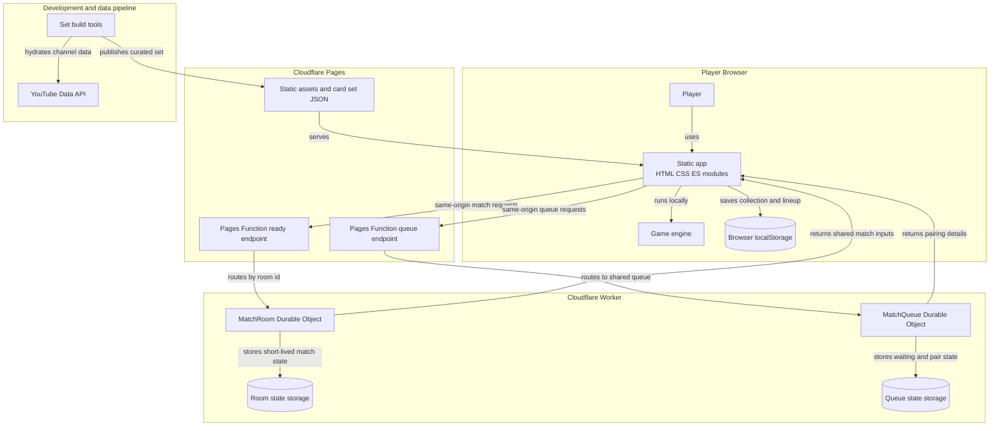
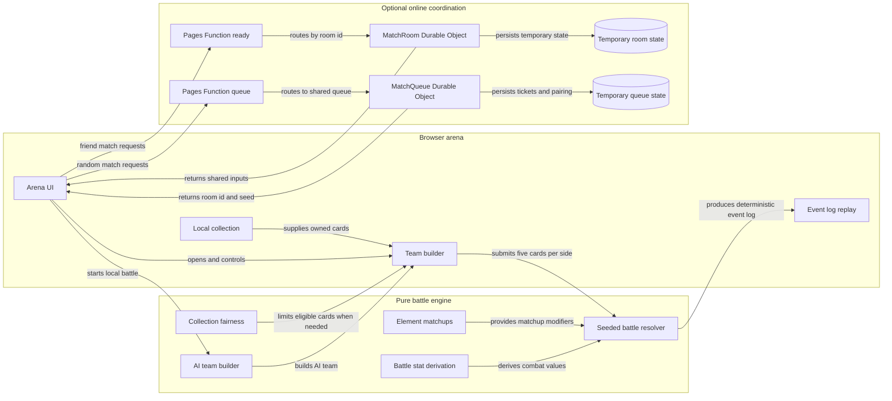

# Architecture Diagram

These diagrams show Creator Gacha as it runs today: a browser-first application with a small optional coordination backend. Battle rules and results stay client-side; Cloudflare coordinates shared inputs for online matches.

## Application Architecture

This is the high-level application and backend view. Quick Battle works without the backend; friend and random-opponent matches use short-lived coordination services.

<!-- mermaid-checked: no \n, no em-dash/en-dash, no {} in labels, subgraphs are id["label"], arrows are -->|"label"|, all subgraphs closed by end, ids unique -->

### Technology Stack Summary

| Layer                                | Technology                               | Version                         | Purpose                                                                                   |
| ------------------------------------ | ---------------------------------------- | ------------------------------- | ----------------------------------------------------------------------------------------- |
| Browser application                  | Vanilla JavaScript ES modules, HTML, CSS | No framework or bundler         | UI, collection, game rules, and battle resolution                                         |
| Browser persistence                  | `localStorage`                         | Browser-provided                | Player collection and lineup                                                              |
| Static hosting and HTTP entry points | Cloudflare Pages and Pages Functions     | Cloudflare managed              | Serves site assets and proxies optional coordination requests                             |
| Match coordination                   | Cloudflare Worker Durable Objects        | Cloudflare managed              | Serializes room and random-queue state                                                    |
| Durable Object storage               | SQLite-backed Durable Object storage API | Cloudflare managed              | Holds temporary room and queue state                                                      |
| Test tooling                         | Vitest                                   | `^4.1.10` in `package.json` | Runs the JavaScript test suite in development                                             |
| Card data pipeline                   | Node.js tools and YouTube Data API v3    | API version v3                  | Builds curated static channel data; YouTube calls are not part of normal browser gameplay |

### Data Storage & External Services

The deployed card set is static JSON served by Cloudflare Pages. A player's collection and lineup stay in that player's browser. The optional backend stores only temporary match coordination data in Durable Objects: a match room holds accepted/entered/locked state and up to five selected channel objects per side, while the random queue holds short-lived waiting and pairing tickets. Neither service stores accounts, permanent collections, or battle results. The YouTube Data API is used by the development data pipeline, not by the normal game session.

### Key Architectural Decisions

- The game engine is pure client-side JavaScript; Quick Battle has no backend dependency.
- Pages Functions are thin public entry points that route requests to Durable Objects, where shared state is strongly consistent.
- Online players receive shared inputs and independently resolve the same seeded battle in their browsers; the server does not decide the winner.

## Component Relationships

This detailed view follows a battle from team selection through resolution. The backend participates only in online setup and synchronization; it does not run combat.

<!-- mermaid-checked: no \n, no em-dash/en-dash, no {} in labels, subgraphs are id["label"], arrows are -->|"label"|, all subgraphs closed by end, ids unique -->

### Component Inventory

| Component              | Layer                | Type                      | Responsibility                                                                               |
| ---------------------- | -------------------- | ------------------------- | -------------------------------------------------------------------------------------------- |
| Arena UI               | Presentation         | Browser UI module         | Drives quick, friend, and random-opponent battle flows                                       |
| Team builder           | Presentation         | Browser UI module         | Builds a five-card team and submits final teams for online matches                           |
| Event log replay       | Presentation         | Browser UI module         | Presents the already-resolved battle events                                                  |
| Local collection       | Browser data         | Browser storage           | Supplies owned cards; remains local to the player                                            |
| Collection fairness    | Battle rules         | Pure engine module        | Computes a temporary eligible slice when collection sizes differ beyond the configured ratio |
| Battle stat derivation | Battle rules         | Pure engine module        | Derives combat values from channel data                                                      |
| AI team builder        | Battle rules         | Pure engine module        | Creates the local opponent team for Quick Battle                                             |
| Element matchups       | Battle rules         | Pure engine module        | Maps channel elements to combat matchup modifiers                                            |
| Seeded battle resolver | Battle rules         | Pure engine module        | Resolves the five-versus-five fight into a deterministic event log                           |
| Ready endpoint         | Coordination         | Cloudflare Pages Function | Validates and forwards match-room requests                                                   |
| Queue endpoint         | Coordination         | Cloudflare Pages Function | Forwards random-opponent queue requests                                                      |
| MatchRoom              | Coordination         | Durable Object            | Coordinates acceptance, shared build, team locks, and match inputs for one room              |
| MatchQueue             | Coordination         | Durable Object            | Pairs waiting players and supplies shared match setup values                                 |
| Temporary room state   | Coordination storage | Durable Object storage    | Holds short-lived room status and locked teams                                               |
| Temporary queue state  | Coordination storage | Durable Object storage    | Holds short-lived queue entries and pair tickets                                             |
